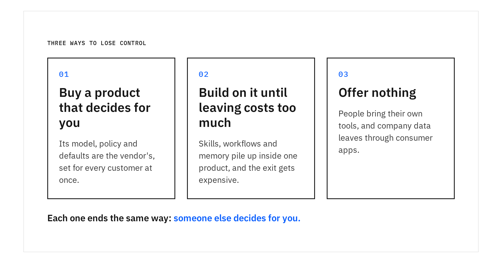
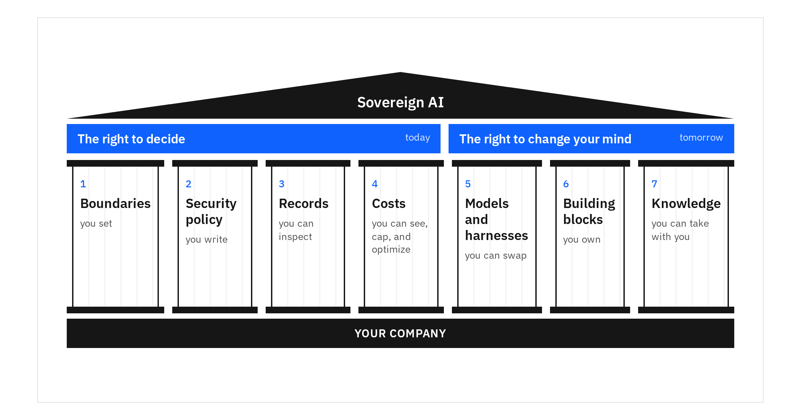
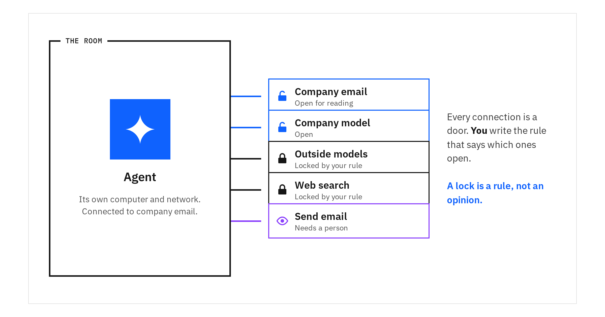
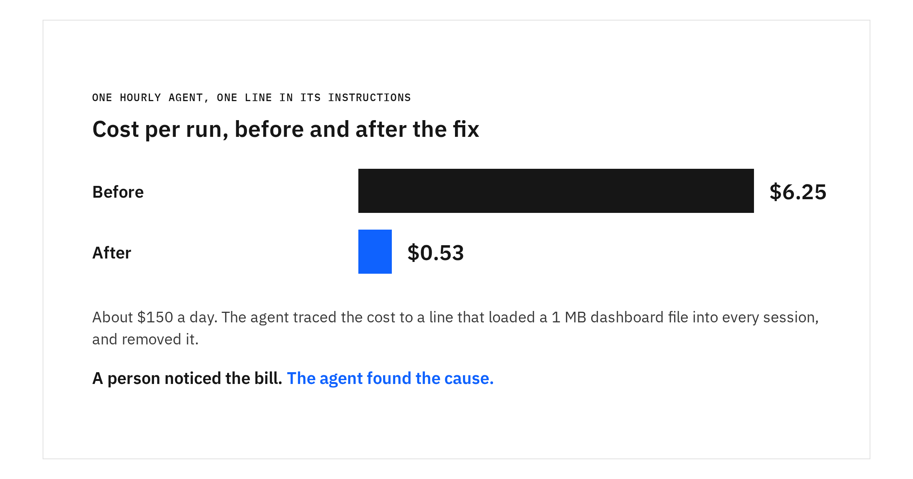
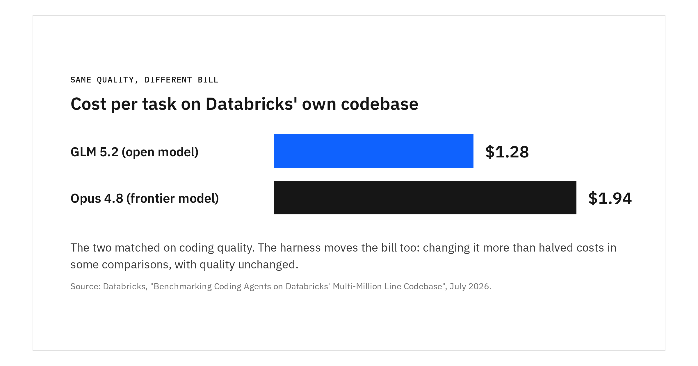
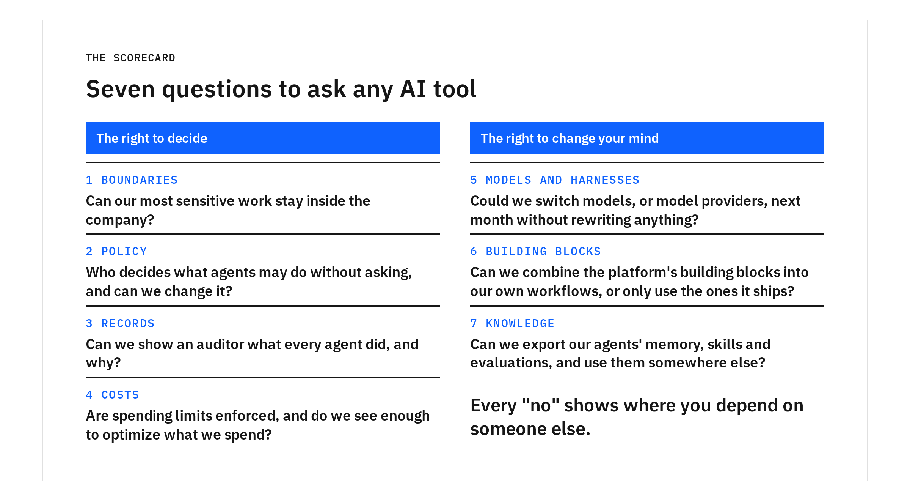

One of our workflows started failing, even though nobody on our team had changed it.

The workflow used an agent to extract text from internal images, some of which contained instructions the agent needed to execute. It ran in Claude Code's auto mode, which decides whether an action is safe to take without asking the user. When Anthropic changed what auto mode allowed, the agent could no longer reliably execute the command.

The vendor's definition of safe had moved, and our workflow moved with it.

That might sound like a small disruption. But agents are no longer just answering questions. They're reading email, running commands, accessing credentials, spending money, and starting other agents. They're becoming part of how work gets done, with access and responsibilities that companies need to govern.

No company would let a staffing agency decide its security policies. Yet an AI vendor can end up supplying the intelligence, the place it works, and the rules for what it may do, all at once.

Sovereign AI is a state an enterprise reaches, not a product it buys. It means holding two rights.

- **The right to decide** is about today. The enterprise chooses what happens to its data, how its agents are secured, and what they cost.
- **The right to change your mind** is about tomorrow. The enterprise can move to another model, tool, or vendor without starting over, whether it wants to or has to.

That doesn't mean owning everything. An enterprise doesn't need to train its own models or run its own GPUs. But it does need to retain control over the decisions that matter, rather than inherit them from a vendor. A growing number of products carry the label "sovereign," but the lock-in underneath is often the same [1].

The test is simple. Does the enterprise decide today, and can it change its mind tomorrow?

## 01 — Three ways to lose control

**Buy a product that decides for you.** Using a vendor's model doesn't automatically mean losing control. The problem starts when the model, the harness that runs the agent, the permission policy, the bill, and the terms all come bundled together. The vendor has made decisions about how your agents work, what they can access, and what happens to your data. Those decisions apply to you whether or not they fit your needs.

**Build on it until leaving costs too much.** Skills, workflows, memory, and evaluations pile up every month. That pile is the company's know-how. If it grows inside one vendor's product, changing your mind gets more expensive until it stops being an option. And change will come, from a better model, a doubled price, or a new law. Today's vendor may be a good one. The risk is that in two years, leaving is no longer practical.

**Offer nothing.** The danger is often not the vendor a company chose, but the ones it did not. Give people no good AI tooling and they bring their own, pasting company data into consumer tools. The company loses both rights without noticing. So part of sovereignty is offering tooling good enough that nobody needs to go around it.

Fig. 1 — Three ways a company loses control of the AI that works inside it.

Avoiding AI products won't fix this, and neither will building everything yourself. What helps is making sure the decisions that matter stay with you. Seven pillars describe what that takes. The first four protect the right to decide. The last three protect the right to change your mind.

Fig. 2 — Seven pillars hold up sovereign AI, grouped under the two rights they protect.

## 02 — The right to decide

The first two pillars set the rules. The next two tell you whether those rules hold, and what they cost. Without them, a company can't judge how much autonomy to give an agent.

### 1. Boundaries you set

An agent can access private data, encounter untrusted content in places like emails and web pages, and take actions on a user's behalf. That combination creates risk. A malicious email, for example, could trick an agent into exposing information it has access to. Guardrails can catch many of these attempts, but as Simon Willison puts it, "in application security, 99% is a failing grade" [2].

That's why boundaries matter. They limit what an agent can access and do, even when its guardrails fail. You can't guarantee an agent will never make a mistake, just as you can't guarantee that of an employee. Instead, companies manage the risk by controlling access. Only employees with the right clearance can access classified information, and the tools they use are restricted accordingly.

The easiest way to picture them is a room with doors.

**The room** is the agent's own workspace, where it reads files and runs tools. But keeping that workspace inside the company doesn't necessarily keep the data there. Many cloud agents copy code onto the vendor's machines to do their work. The agent also sends information to its model every time it reasons, including its instructions, the files it reads, and the results of its tools. If that model runs outside the company, that information leaves too. For the most sensitive workloads, both the workspace and the model can run inside the company's own environment. Other workloads may not need that level of control. The important thing is that the company gets to decide.

**The doors** are the connections the agent can use to reach other systems. The company decides which ones are open, which are blocked, which allow limited access, and which require someone's approval. An agent might be allowed to read company email but not send messages without approval. It might access internal documentation but be blocked from sending that information to an outside model.

These rules can also change based on what an agent is connected to. For example, when an agent connects to company email, the company might automatically block outside models and web search while requiring human approval before the agent can send a message. Connecting to sensitive data changes which other connections are permitted. The agent doesn't get to decide whether those restrictions apply. They're enforced by the platform.

A lock is a rule, not an opinion.

Fig. 3 — Every connection is a door. The company writes the rules for which ones open.

The room and its doors also let an enterprise give agents more freedom, such as a whole computer to build and test on, because anything that goes wrong stays inside. Without those boundaries, the enterprise must either keep agents away from its most valuable work or accept the risk of a leak.

### 2. Security policy you write

Boundaries determine what an agent can reach, access, and send data to. Policy determines what it can do once it has access. Should a coding agent be allowed to delete a branch without asking? Can it merge code or deploy to production? Can an agent act on a request it finds in a customer email?

Today, those decisions are often built into the vendor's tools, and they can change with a software update. That's what happened with our workflow.

Companies need to make these decisions themselves. A documentation agent might be allowed to browse freely. A coding agent might be able to create branches and open pull requests but not merge them. A production agent might have access to deployment systems but need approval before making changes.

In practice, this means having a company-defined policy for what agents can do without asking. These rules should live outside the agent's harness and apply consistently, regardless of which model or tool runs it. A policy created once should govern every agent doing that kind of work, rather than being reimplemented for each tool.

### 3. Records you can inspect

Records show what agents actually did. Without them, giving an agent autonomy means trusting it blindly.

Auditability is also what makes greater autonomy possible. Teams can expand what an agent is allowed to do when they can see what it did with the access it already had. Records give the enterprise evidence to support those decisions, and evidence it can show an auditor or regulator.

An enterprise needs to know who owns each agent, what systems it accessed, what actions it took, and what information and instructions it relied on. It needs to see traces, telemetry, and spending without requiring every owner to have access to the underlying infrastructure.

Debug logs often aren't enough, and records kept only in a vendor's console may be lost when a company moves to another platform. The ability to inspect what happened should belong to the enterprise, not depend on which product happened to run the agent.

### 4. Costs you can see, cap, and optimize

The more autonomy an agent has, the more its costs matter. It may call several models, start subagents, and run on a schedule long after its owner has gone home. A single bill says little about which work was worth it.

An enterprise needs to see spending by team, agent, model, and workflow, and to cap it. An enforced limit stops a runaway task. A report tells you about it afterwards.

As IBM's CEO Arvind Krishna put it, “if your supplier built the AI operating layer, it is not a control; it is a meter.” [6]

Agents can help bring costs down, too. We saw this firsthand. One of our hourly agents was costing about $6.25 per run, or roughly $150 a day. When someone flagged the spend, the agent traced it to a line in its own instructions that pulled a 1 MB dashboard file into every session. It removed that instruction, and the next run cost $0.53.

A person noticed the bill. The agent found the cause.

Fig. 4 — One line in an agent's instructions cost about $150 a day.

We now run an agent that watches for cost spikes and unusual spending and recommends when something needs review. We're also building agents to monitor security advisories and recommend the best model and harness for different types of work.

There's more room to optimize. Agents can review other agents' spending, identify inefficient behavior, and suggest changes or make them within defined limits. Enterprises can also schedule work during cheaper periods, distribute workloads across available models, and use caching to avoid paying repeatedly for the same information.

## 03 — The right to change your mind

The first four pillars give an enterprise control over how agents operate today. The next three protect its ability to evolve without losing what it has built.

### 5. Models and harnesses you can swap

The best model for a task today may not be the best one six months from now. In a benchmark on its own multi-million-line codebase, Databricks found that the open model GLM 5.2 matched Opus 4.8 on coding quality, at $1.28 per task compared with $1.94 [3]. The same benchmark found that changing the harness could more than halve costs in some comparisons, with quality remaining the same [3]. In one IBM test, an open-weight model sped up a quantum hardware design 52-fold for $26 in inference. A leading proprietary model did better, 204-fold, but cost $299. As Krishna puts it, "You should decide which work runs where, and on whose terms." [6]

Fig. 5 — Same quality, different bill. Source: Databricks [3].

And not every task needs a frontier model. Much of the work agents do involves classifying tickets, routing cases, and making other straightforward decisions. Models built specifically for these tasks are emerging too. Jev's maker reports that it can be 40 to 200 times faster than frontier models on certain structured decision tasks [4], with open alternatives close behind [5].

The next model an enterprise chooses may not generate prose at all. It may be a specialized model designed to make one kind of decision, with a structured answer and a confidence score. The enterprise that gets the most from its AI investment will likely run many models, each chosen for the work it does best.

The harness matters just as much. It determines how an agent handles context, uses tools, and applies permissions. Changing the model while remaining tied to one harness still leaves an enterprise dependent on the vendor's architecture.

Companies will want to move between models and harnesses as better or cheaper options become available. That gets much harder when skills, policies, and workflows are tied to a particular harness. Keeping them separate makes switching possible without rebuilding the agent each time.

Choosing the right model for each task is itself work an agent can help with. An advisor agent could compare available models and harnesses against the company's own workloads, evaluating cost and quality and recommending alternatives when better options become available. It could repeat that evaluation whenever a new model enters the company's available set.

### 6. Building blocks you own

Owning an agent isn't the same as owning everything it depends on. A harness determines how an agent runs, but running agents across an enterprise takes more than a harness. It takes infrastructure the company can manage and change independently.

Four building blocks do much of that work.

- **Persistent agents** keep their workspaces between runs, so they can pick up where they left off instead of starting over.
- **Schedules** let agents run on a timer, with a lightweight check first to see whether there's work to do.
- **Connections** let agents reach company systems without handling the credentials themselves.
- **Subagents** let an agent delegate work with only the access needed for that task, rather than passing along all of its permissions.

Together, these building blocks make it possible to create workflows that run across tools and systems. If they belong to a vendor, those workflows are tied to that vendor's architecture. When it changes, the company has to adapt or rebuild its work.

Owning these building blocks also makes it possible to compose different workflows for different kinds of work. One model can plan, another can implement, and a third can review the result. A cheaper harness can handle routine tasks while a more capable one handles complex work. The enterprise isn't limited to the architecture a vendor chose to package. It can build the combination each task deserves.

Connections are often the hardest part. Researchers regularly ask us to connect agents to systems inside the company network, including license servers, compute clusters, and lab machines accessed over SSH. Our own deployment can't reach those systems, and for good reason. As AI makes attacks easier to carry out, companies are tightening access to internal systems.

Making these connections work takes more than opening a network port. Each person needs the right access, credentials may need to be short-lived, and some workers may need to run inside the secure network rather than reaching into it. An agent might authenticate as its owner through a single sign-on flow, use short-lived credentials, or send a request to a worker already inside a protected network. It's not simple work, but it's part of what it takes to make agents useful inside an enterprise.

### 7. Knowledge you can take with you

Pillar six is about the infrastructure agents run on. This pillar is about what agents learn while they work for you.

Every team runs on knowledge nobody wrote down. How a good code review reads, what a customer actually means when they say "urgent," which reports leadership skims and which they read. People call this tacit knowledge. It lives in people's heads, and it's hard to hand over when someone leaves.

Agents pick up the same kind of knowledge. An agent that works with a team for months learns its preferences, its shortcuts, and its definition of done. Unlike a person, though, most of what an agent knows sits outside the model, in its memory, its skills, its instructions, and the evaluations that score its work. That makes it far easier to transfer. It can be copied, shared, and reused across teams, as we described in [Agents as Teammates](https://dam-agents.github.io/ai-industrialization-blog/posts/agents-as-teammates.html). You don't share files, you share intelligence.

But that only works if the company can get it out. Many AI products tailor themselves to how you work and offer no real way to take that with you. One migration between AI assistants amounted to a prompt asking the old one to "tell me everything you know about me," pasted into the new one. It sort of worked. Nobody would call it a guarantee.

A company should know, before it commits, that its agents' memory, skills, and evaluations can be exported in a form another system can use. A skill should keep working after its author changes teams. A new hire should get the team's way of working on day one. And when a new model arrives, the company's own evaluations, not the vendor's benchmark, should decide whether it's good enough.

Models and harnesses can be swapped. What your agents have learned about how your company works shouldn't have to stay behind.

## 04 — When you don't need all seven

Sovereignty comes with tradeoffs. Running your own platform takes people and resources, and open models aren't the best choice for every task. A team using AI to brainstorm doesn't need the same level of control as a team using agents to work with customer records or make decisions on its behalf. For many everyday tasks, a vendor product may be the right choice.

The important thing is knowing where more control matters. Focus first on the agents handling sensitive data or taking actions without human approval. You don't have to own everything. You need to understand what you're trusting a vendor to control, what you're keeping in your own hands, and whether you can change that arrangement later.

## 05 — Two rights, seven pillars

Nobody needs to build all seven pillars at once. But they help you understand where control matters for your company and whether you actually have it. Use them to evaluate any AI tool or platform.

**Boundaries.** Can our most sensitive work stay inside the company?

**Policy.** Who decides what agents may do without asking, and can we change it?

**Records.** Can we show an auditor what every agent did, and why?

**Costs.** Are spending limits enforced, and do we see enough to optimize what we spend?

**Models and harnesses.** Could we switch models, or model providers, next month without rewriting anything?

**Building blocks.** Can we combine the platform's building blocks into our own workflows, or only use the ones it ships?

**Knowledge.** Can we export our agents' memory, skills and evaluations, and use them somewhere else?

Fig. 6 — The seven questions on one page.

Every "no" tells you where your company is depending on someone else, and whether that's a dependency you're comfortable with.

There is still plenty to figure out. Connections have been the hardest part for us so far, and we don't yet know how much work it will take for smaller, specialized models to handle more of the tasks we rely on frontier models for.

At IBM Research, we're building DAM (Deploy Agents Massively), an open source project designed around these principles. It's one way to put the pillars into practice, but it isn't the only way. You can explore the project at [github.com/dam-agents/dam](https://github.com/dam-agents/dam), or, if you're an IBMer, get started at [ibm.biz/dam-agents](https://ibm.biz/dam-agents).

The bigger question is what your company needs to own, and where it is comfortable relying on someone else. We'd like to hear how you're thinking about it. Join the conversation on [GitHub Discussions](https://github.com/dam-agents/dam/discussions/6517).

## References

<ol class="post-refs">
  <li>Stanford HAI, "The Commercial Landscape of AI Sovereignty Offerings", issue brief by C. Meinhardt, J. N. Pava, C. Yee, and J. A. Landay, July 2026. <a href="https://hai.stanford.edu/policy/the-commercial-landscape-of-ai-sovereignty-offerings">https://hai.stanford.edu/policy/the-commercial-landscape-of-ai-sovereignty-offerings</a></li>
  <li>Simon Willison, "Prompt injection explained, with video, slides, and a transcript", May 2023. <a href="https://simonwillison.net/2023/May/2/prompt-injection-explained/">https://simonwillison.net/2023/May/2/prompt-injection-explained/</a></li>
  <li>Databricks, "Benchmarking Coding Agents on Databricks' Multi-Million Line Codebase", July 2026. <a href="https://www.databricks.com/blog/benchmarking-coding-agents-databricks-multi-million-line-codebase">https://www.databricks.com/blog/benchmarking-coding-agents-databricks-multi-million-line-codebase</a></li>
  <li>TypeSafe AI, "Introducing System One Models &amp; Jev", September 15, 2026. <a href="https://typesafe.ai/blog/introducing-system-one-models-and-jev">https://typesafe.ai/blog/introducing-system-one-models-and-jev</a></li>
  <li>Kev, "Jev-like family of decision models built on top of Qwen3.5/3.8 you can train and run on your own", Apache-2.0. <a href="https://github.com/jaredpalmer/kev">https://github.com/jaredpalmer/kev</a></li>
  <li>Arvind Krishna, "IBM CEO: rationing AI is a slow way to lose", Fortune, November 5, 2026. <a href="https://fortune.com/2026/11/05/ibm-arvind-krishna-ai-inference-cost-curve-rationing-tokens">https://fortune.com/2026/11/05/ibm-arvind-krishna-ai-inference-cost-curve-rationing-tokens</a></li>
</ol>
